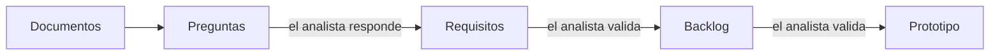

# Concilia

Concilia convierte la documentación de un proyecto de software en **preguntas para el cliente**, un **catálogo de requisitos**, un **backlog ágil** y un **prototipo navegable**, con verificación cruzada entre modelos de IA: dos modelos hacen cada tarea por separado y un tercero, el **árbitro**, compara sus resultados, los une y señala lo que no cuadra para que lo revise una persona.

El nombre viene de *conciliar* dos versiones. Es un Trabajo Fin de Grado de la Universidad de Zaragoza, desarrollado durante unas prácticas en Integra Tecnología.

## Por qué

Un modelo de IA por sí solo puede olvidar información, inventar o contradecirse, y no hay una forma barata de saberlo. Concilia repite cada tarea con dos modelos independientes y compara las salidas: lo que coincide da más confianza, y las discrepancias llegan al analista antes de validar. La hipótesis del trabajo es que este patrón es más fiable que usar un único modelo.

## Qué hace



| Fase | Resultado | Quién lo genera |
| --- | --- | --- |
| **Documentos** | El texto de Word, PDF, Excel, CSV, PowerPoint, HTML, correos, transcripciones, Markdown, JSON, YAML o XML, dividido en fragmentos citables (`DOC-01#F007`). | La plataforma |
| **Preguntas** | Las dudas que hay que aclarar con el cliente, por rondas. La IA puede sugerir cada respuesta. | Modelo A ‖ modelo B → árbitro |
| **Requisitos** | Catálogo en [EARS](https://en.wikipedia.org/wiki/Easy_Approach_to_Requirements_Syntax) y MASTeR, con las fuentes y las respuestas en que se apoya cada requisito. Se exporta a Word y PDF. | Modelo A ‖ modelo B → árbitro |
| **Backlog** | Épicas, historias, criterios de aceptación en Gherkin y tareas. Se exporta a [Gherkin, Jira, Azure DevOps y GitHub](#llevar-el-backlog-a-otras-herramientas). | Modelo A ‖ modelo B → árbitro |
| **Prototipo** | Una aplicación navegable con inicio de sesión, un espacio por rol y datos de prueba. | Un modelo, pantalla a pantalla |

Además:

- **Iteraciones:** la documentación se agrupa en las tandas en que llega. Con una tanda nueva, las preguntas se centran en lo nuevo, y el catálogo y el backlog validados se actualizan con un conjunto de cambios que el analista acepta o rechaza.
- **Trazabilidad:** de cada requisito a sus fragmentos, sus respuestas y sus historias, y de cada historia a sus requisitos.
- **Historial de versiones:** cada versión del catálogo, el backlog y el prototipo se puede ver, comparar con la actual y recuperar.
- **Comparación e informes:** una vista de A, B y el árbitro lado a lado, y por cada trabajo sus tokens, tiempos, coste, acuerdos, discrepancias y cambios del analista.

### Cómo se verifica

1. A y B reciben el mismo prompt y no saben uno del otro. Si uno falla, el trabajo falla: nunca se presenta como verificado el resultado de un solo modelo.
2. La plataforma empareja las dos propuestas por significado, con *embeddings* calculados en local.
3. El árbitro recibe las propuestas anónimas y en orden aleatorio, parte de ese emparejamiento y las une.
4. Lo que el árbitro marca, y lo que decide en contra del emparejamiento, llega al analista como discrepancia.
5. Cada salida se valida (esquema, referencias, que se haya leído toda la documentación). La plataforma corrige sola los errores con una única solución posible; para el resto, el modelo repara solo las líneas afectadas.

Cada fase solo ve la versión validada de la anterior.

## Stack

| Capa | Tecnología |
| --- | --- |
| Web | React 19, TypeScript, Vite y Tailwind |
| API | .NET 10 (ASP.NET Core), EF Core y OpenAPI 3.1 con Swagger UI |
| Base de datos | PostgreSQL |
| Modelos | Claude Code en modo no interactivo (`claude -p`), conectado a una pasarela LiteLLM o, para el modelo B, a OpenCode Go; el modelo y el proveedor de cada papel son configuración |
| *Embeddings* | `paraphrase-multilingual-MiniLM-L12-v2` con ONNX Runtime, dentro de la API |
| Despliegue | Docker Compose |

## Puesta en marcha

Hace falta [Git](https://git-scm.com/downloads) y [Docker Desktop](https://www.docker.com/products/docker-desktop/) abierto, unos 8 GB de RAM y 10 GB libres en disco.

```bash
git clone https://github.com/carlosalejoss/Concilia.git concilia
cd concilia
cp .env.example .env        # en PowerShell: Copy-Item .env.example .env
```

Escribe en `.env` una contraseña cualquiera para la base de datos (`POSTGRES_PASSWORD=...`) y arranca:

```bash
docker compose up --build -d
```

La primera vez tarda varios minutos. Después abre <http://localhost:8080>, crea un proyecto y sube los documentos de [`ejemplos/mediano-banco-de-alimentos/`](ejemplos/mediano-banco-de-alimentos/).

Sin más configuración funciona en **modo simulado**: el proveedor `Fake` imita a los modelos, de modo que se puede recorrer todo el flujo en segundos, sin coste ni credenciales.

### Usar modelos reales

Añade a `.env` los datos de tu pasarela LiteLLM y aplica los cambios con `docker compose up -d`:

```text
RUNNER_PROVIDER=LiteLlm
LITELLM_BASE_URL=<dirección de la pasarela>
LITELLM_API_KEY=<clave de la pasarela>
RUNNER_MODEL_A=<id del modelo A>
RUNNER_MODEL_B=<id del modelo B>
RUNNER_MODEL_ARBITER=<id del modelo árbitro>
RUNNER_MODEL_SUGGESTIONS=<id del modelo de las sugerencias>
MOCKUP_PROVIDER=LiteLlm
MOCKUP_MODEL=<id del modelo del prototipo>
```

[`.env.example`](.env.example) explica todas las variables. Con modelos reales cada tarea tiene coste: el flujo completo de un proyecto grande ronda los 22 $ ([detalle por fase](docs/costes/costes.md)).

**Un proveedor por papel.** Cada papel puede ir por un proveedor distinto (`RUNNER_PROVIDER_A`, `_B`, `_ARBITER` y `_SUGGESTIONS`; vacíos, el de `RUNNER_PROVIDER`). Desde el hito 25, el modelo B va por [OpenCode Go](https://opencode.ai/docs/go) y el resto sigue en la pasarela:

```text
RUNNER_PROVIDER_B=OpenCodeGo
RUNNER_MODEL_B=<id del modelo en OpenCode Go, por ejemplo kimi-k3.1-pro>
OPENCODE_GO_API_KEY=<clave de un espacio de trabajo con Go>
```

El runner sigue siendo Claude Code: para B solo cambian la dirección (la pública de OpenCode Go para Claude Code, por defecto) y la clave. La clave de OpenCode solo llega a los procesos de B, y la de la pasarela nunca llega a ellos. Sin la clave, la API arranca, pero no deja lanzar las tareas que usan B y dice qué variable falta. Úsalo solo con documentos ficticios o públicos.

### Operación

| Para… | Comando |
| --- | --- |
| Parar (los datos se conservan) | `docker compose down` |
| Volver a arrancar | `docker compose up -d` |
| Actualizar el código | `git pull` y `docker compose up --build -d` |
| Ver qué dice la API | `docker compose logs api` |
| Borrar todos los datos | `docker compose down -v` y borrar la carpeta `data/` |

Reconstruir la API interrumpe los trabajos en curso: al arrancar quedan cerrados como fallidos y se pueden volver a lanzar.

### Problemas frecuentes

| Problema | Solución |
| --- | --- |
| `Cannot connect to the Docker daemon` | Abre Docker Desktop y espera a que indique *Engine running*. |
| `Set POSTGRES_PASSWORD in .env` | Falta `.env` o su contraseña. |
| El puerto 8080 está ocupado | Cambia `"127.0.0.1:8080:80"` en `docker-compose.yml`, por ejemplo por `"127.0.0.1:8081:80"`. |
| Falla la primera construcción al descargar algo | Suele ser la red: repite el comando. Detrás de un proxy, configúralo en Docker Desktop (*Settings → Resources → Proxies*). |

## Llevar el backlog a otras herramientas

En la barra de **Backlog** están las descargas: **Gherkin** (un `.feature` por épica), **CSV Jira**, **CSV Azure DevOps** y **GitHub**. Salen de la versión guardada, así que conviene revisar y validar el backlog antes.

Cada importación en Jira o Azure DevOps crea elementos nuevos: repetirla, por ejemplo tras una iteración, los duplica. Solo el script de GitHub distingue lo que ya está.

| Destino | Qué crea | Límite por importación | Probado en real |
| --- | --- | --- | --- |
| Jira Cloud | Épica → historia → subtarea | 250 elementos sin ser administrador | Sí |
| Azure DevOps | Epic → User Story → Task | 1.000 elementos | No, solo el formato del fichero |
| GitHub | Issues unidos como sub-issues | 500 creaciones por hora, las del propio GitHub | Sí |

### Importar en Jira Cloud

Necesitas un espacio y los permisos de crear elementos y de hacer cambios masivos. La ruta y los nombres pueden variar según el idioma y la versión de tu Jira ([documentación de Atlassian](https://support.atlassian.com/jira-software-cloud/docs/create-issues-using-the-csv-importer/)).

1. Descarga el fichero con **CSV Jira**.
2. En Jira, ve a **Filters → Search work items**, abre **More actions (•••)** y elige **Import work items from CSV**.
3. Selecciona el fichero, deja sin marcar el fichero de configuración y pulsa **Next**.
4. Elige el espacio de destino y comprueba que el delimitador es la coma.
5. Asigna las columnas:

   | Columna del CSV | Campo de Jira |
   | --- | --- |
   | `Issue ID` | Issue ID |
   | `Parent ID` | Parent |
   | `Issue Type` | Issue Type (`Epic`, `Story` y `Sub-task`, con sus equivalentes en tu idioma) |
   | `Summary` | Summary |
   | `Description` | Description |
   | Todas las `Labels` | Labels |
   | `Epic Name` | Epic Name, o sin asignar si tu espacio no lo tiene |

6. Pulsa **Validate** y después **Begin import**. La validación puede contar menos elementos de los que crea, porque las subtareas se crean al final.

**Si tienes más de 250 elementos y no eres administrador**, pide a un administrador que lo importe desde **Settings → System → External System Import → CSV**, o divide el CSV por épicas con un editor de texto: cada fichero con la fila de cabecera y cada elemento junto a su padre.

### Importar en Azure DevOps

Necesitas un proyecto con el **proceso Agile**, que es el que tiene *User Story*, y pertenecer a **Project Administrators** ([documentación de Microsoft](https://learn.microsoft.com/es-es/azure/devops/boards/queries/import-work-items-from-csv)).

1. Descarga el fichero con **CSV Azure DevOps**.
2. En tu proyecto, ve a **Boards → Queries → Import work items**.
3. Pulsa **Choose file**, selecciona el fichero y pulsa **Import**. Los elementos aparecen sin guardar y aún sin número.
4. Corrige los que salgan marcados en rojo.
5. Pulsa **Save items**.

Si superas los 1.000 elementos, divide el CSV por épicas, como en Jira.

### Subir el backlog a GitHub

GitHub no importa archivos, así que Concilia da un `.zip` con un script que lanzas tú con tu cuenta; Concilia no recibe ningún token.

Una sola vez, instala [GitHub CLI](https://cli.github.com) 2.94 o superior, inicia sesión con `gh auth login` y crea un repositorio, mejor privado y sin seguidores, porque cada issue creado envía una notificación. En Windows, usa Git Bash, que viene con Git.

1. Descarga el `.zip` con **GitHub** y descomprímelo.
2. Abre un terminal en esa carpeta, donde está `importar.sh`. En Windows: clic derecho en un hueco vacío y **Open Git Bash here** (si no aparece, en **Mostrar más opciones**).
3. Comprueba la sesión con `gh auth status`. Si dice `command not found`, ejecuta `export PATH="/c/Program Files/GitHub CLI:$PATH"` y repite.
4. Haz un ensayo, que no crea nada:

   ```bash
   bash importar.sh tu-usuario/tu-repositorio --simular
   ```

5. Si lo que muestra te cuadra, súbelo. Tarda unos 5 segundos por issue:

   ```bash
   bash importar.sh tu-usuario/tu-repositorio
   ```

Si se corta a medias, vuelve a lanzarlo: sigue por donde iba y no duplica nada. Si lo ha cortado GitHub por sus límites, espera unos minutos antes.

Tras una iteración, descarga el `.zip` de nuevo y lanza el mismo comando. Crea solo lo nuevo; lo modificado o eliminado no se toca, y el script da el comando que aplica cada cambio. Un backlog generado otra vez desde cero vuelve a numerar sus ids y necesita otro repositorio: si lo detecta, el script se para sin crear nada. No borres la última línea del cuerpo de un issue, invisible al leerlo (`<!-- concilia:… -->`), porque es la que lo identifica.

## Desarrollo

Con .NET 10 y Node 24:

| Para… | Comando |
| --- | --- |
| Arrancar la API, en <http://localhost:5292> (necesita PostgreSQL en `ConnectionStrings__Default`) | `dotnet run --project src/Concilia.Api --launch-profile http` |
| Arrancar la web, en <http://localhost:5173> | `npm install` y `npm run dev`, dentro de `frontend/` |
| Ejecutar los tests | `dotnet test src/Concilia.slnx` |
| Descargar el modelo de *embeddings* (470 MB) | `.\scripts\descargar-modelo-embeddings.ps1` |

Los tests no llaman a ningún modelo real. Sin el modelo de *embeddings*, la API usa `Fake` y los tests que lo necesitan se saltan.

La API está documentada con OpenAPI 3.1. Con la aplicación en marcha, Swagger UI está en <http://localhost:8080/swagger>, y hay una copia del documento en [`docs/api/openapi.json`](docs/api/openapi.json). Un test falla si un endpoint queda sin documentar.

```text
concilia/
├── src/         # solución .NET: Concilia.Api, Concilia.Core y Concilia.Runner
├── tests/       # tests de la solución .NET
├── frontend/    # aplicación React
├── prompts/     # prompts versionados
├── ejemplos/    # dos proyectos ficticios con su documentación
├── scripts/     # modelo de embeddings, calibración, evaluación y costes
├── docs/        # plan de construcción, resultados y evolución de los prompts
└── data/        # archivos de cada proyecto y trabajo (fuera de git)
```

## Evaluación

La primera evaluación (modelo B = LUNA, versión [descrita aquí](docs/evaluacion/version.md)) se interrumpió el 10-11-2026. El modelo B pasa a un modelo de otro fabricante, y la evaluación se repetirá desde cero con él. La tabla recoge lo que dio la primera.

| Pregunta | Estado |
| --- | --- |
| ¿El árbitro prefiere la propuesta de su propio modelo? | No ([experimento](docs/experimento-sesgo-arbitro.md)) |
| ¿Funciona con un documento público y en inglés? | Sí, con un documento del conjunto PURE ([resultados](docs/evaluacion/pure.md)) |
| ¿Qué calidad miden herramientas externas (AQUSA y `vale-ears`)? | [Resultados](docs/evaluacion/metricas-externas.md) |
| ¿Cómo se usa como analista? | [Prueba](docs/evaluacion/analista.md) |
| ¿Es más fiable que un solo modelo? ¿Cuánto varía entre repeticiones? | En la evaluación 2, con el nuevo modelo B |

La evolución de los prompts está en [`docs/evolucion-prompt-requisitos.md`](docs/evolucion-prompt-requisitos.md), y lo que queda por hacer, en [`docs/plan-de-construccion.md`](docs/plan-de-construccion.md).

## Seguridad y datos

Las credenciales se pasan por variables de entorno y `.env` nunca se sube al repositorio. La plataforma oculta la clave y la dirección de la pasarela, y la clave de OpenCode Go, en registros, eventos y base de datos; cada proceso de un modelo recibe solo las credenciales de su proveedor. Los *embeddings* se calculan en local; el texto de los documentos sí llega a los modelos configurados, así que elige una pasarela adecuada para tus datos. La plataforma no tiene usuarios ni contraseñas, así que solo escucha en el propio equipo (`127.0.0.1:8080`): desde otro equipo de la red no se puede abrir ni lanzar tareas que gasten.

## Licencia

Sin definir todavía.

## Autoría

Carlos Alejos Fumanal. Tutores: Francisco Javier Zarazaga-Soria y Patricia Berdejo.
