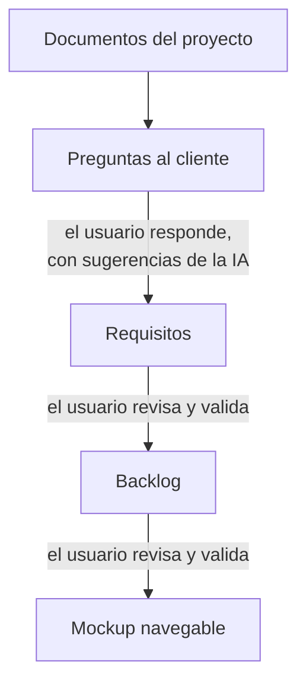

# Concilia

Plataforma web que genera **catálogos de requisitos**, **backlogs ágiles** y un **prototipo navegable** a partir de la documentación de un proyecto, con verificación cruzada entre modelos de IA: dos modelos hacen cada tarea por separado y un tercero, el **árbitro**, compara sus resultados y los une en uno solo, señalando lo que no cuadra para que lo revise el usuario.

El nombre viene de *conciliar* dos versiones. Es el Trabajo Fin de Grado del autor, desarrollado durante sus prácticas en el equipo de análisis de software de Integra Tecnología (Zaragoza).

## Estado

El flujo funciona de principio a fin: documentos → preguntas → requisitos → backlog → mockup, con prompts básicos (iteración v0, de la v0.1 a la v0.11) probados con los modelos de la pasarela de la empresa. El árbitro parte de un emparejamiento por embeddings calculado en local, y la plataforma corrige sola los errores de formato más comunes. Cada trabajo deja un informe con sus tokens, tiempos, coste, acuerdos y discrepancias entre modelos y los cambios del usuario: es la base de la evaluación. Lo que queda está en la [hoja de ruta](#hoja-de-ruta) y en [`docs/plan-de-construccion.md`](docs/plan-de-construccion.md).

## La idea

Un modelo de IA por sí solo puede olvidar información, inventar o contradecirse, y no hay una forma barata de saberlo. Concilia reduce ese riesgo repitiendo cada tarea con dos modelos independientes y comparando ambas salidas: lo que coincide da más confianza, y las discrepancias se marcan para que el usuario las revise antes de validar.

La hipótesis del TFG es que este patrón mejora la fiabilidad frente a usar un único modelo.

## Cómo funciona



| Paso | Qué hace | Cómo |
| --- | --- | --- |
| Documentos | Sube la documentación: Word, PDF, Excel, CSV, PowerPoint, páginas web, correos, transcripciones de reuniones, texto, Markdown, JSON, YAML o XML. Un `.zip` con un mockup del cliente sirve de referencia de estilo. | La plataforma extrae el texto y lo divide en fragmentos citables (`DOC-01#F007`). |
| Preguntas | Las dudas que hay que aclarar con el cliente, en rondas. La IA puede proponer cada respuesta. | Modelo A ‖ modelo B → árbitro |
| Requisitos | El catálogo en EARS y MASTeR, con sus fuentes y las preguntas en que se apoya. Desde cada requisito se ve su trazabilidad: el texto de sus fragmentos, las respuestas en que se apoya y las historias que lo cubren (y, desde cada historia, al revés). Se descarga en Word o PDF. | Modelo A ‖ modelo B → árbitro |
| Backlog | Épicas, historias, criterios de aceptación en Gherkin y tareas. Se descarga como ficheros `.feature` de Gherkin y como CSV para importarlo en Jira o en Azure DevOps. | Modelo A ‖ modelo B → árbitro |
| Mockup | Un prototipo navegable de toda la aplicación: inicio de sesión con usuarios de prueba, una aplicación por rol y navegación real. | Un modelo, por pasos: el diseño, cada pantalla, y la plataforma junta y corrige lo que no encaja. |

En las tres fases con árbitro, A y B reciben el mismo prompt y no saben uno del otro. El árbitro recibe las dos propuestas en orden aleatorio, sin saber de qué modelo es cada una, y marca para cada elemento si viene de las dos, de una sola o si hay una discrepancia. Antes, la plataforma empareja las dos propuestas por significado con embeddings calculados en local, sin IA generativa, y el árbitro parte de ese emparejamiento. Si el árbitro se aparta de él (une lo que los números ven distinto o separa lo que ven igual), la plataforma lo marca como discrepancia. Si uno de los dos modelos falla, el trabajo falla: no se acepta la salida de un solo modelo. El usuario revisa cada discrepancia antes de validar, y cada paso solo ve la versión validada del anterior.

Los modelos se ejecutan con Claude Code en modo no interactivo (`claude -p`): leen sus entradas por partes con `Read`, escriben su salida con `Write` y terminan con un veredicto. La plataforma valida cada salida (esquema, referencias, que se haya leído todo). Los errores de formato más comunes (un número de línea citado como fragmento, ids mal numerados, un elemento que el árbitro olvidó) los corrige ella sola, con un aviso. Para el resto pide una reparación: el modelo corrige con `Edit` solo las líneas de su salida que tienen errores.

### Notaciones de requisitos

- **[EARS](https://en.wikipedia.org/wiki/Easy_Approach_to_Requirements_Syntax)** es la notación por defecto: plantillas con palabras clave fijas, fáciles de generar y de comprobar automáticamente.
- **MASTeR** (plantillas SOPHIST) se usa para requisitos no funcionales o complejos y para expresar el grado de obligatoriedad (shall, should, may).

La comparación entre notaciones se apoya en [Großer et al., 2024](https://link.springer.com/article/10.1007/s00766-024-00427-0).

## Stack

| Capa | Tecnología |
| --- | --- |
| Frontend | React 19, TypeScript, Vite y Tailwind |
| Backend | .NET 10 (ASP.NET Core) y EF Core |
| Base de datos | PostgreSQL |
| Modelos de IA | Pasarela LiteLLM de la empresa; qué modelo hace cada papel (A, B, árbitro, sugerencias, mockup) es configuración |
| Ejecución de los modelos | Runner en .NET que lanza Claude Code no interactivo (`claude -p`), con salida stream-json y veredicto final obligatorio |
| Embeddings | `paraphrase-multilingual-MiniLM-L12-v2` (Apache 2.0) en ONNX, con ONNX Runtime dentro de la API: en local, sin enviar datos fuera |
| Documentación de la API | OpenAPI 3.1 generado por ASP.NET Core (Microsoft.AspNetCore.OpenApi) y Swagger UI (Swashbuckle.AspNetCore.SwaggerUI, MIT) |
| Exportación | Word con DocumentFormat.OpenXml (MIT), PDF con MigraDoc 6.2.4 (MIT, la última versión con esa licencia) y la fuente IBM Plex Sans (OFL), y Gherkin comprobado con el analizador oficial de Cucumber (MIT) |
| Despliegue | Docker y Docker Compose |

## Estructura del repositorio

```text
concilia/
├── docs/        # plan de construcción, decisiones por hito, evolución de los prompts y api/openapi.json
├── prompts/     # prompts versionados: v0/ (el flujo actual) y generacion_requisitos/ (catálogo v1.x y v2)
├── src/         # solución .NET: Concilia.Api, Concilia.Core (dominio) y Concilia.Runner
├── tests/       # tests de la solución .NET
├── frontend/    # aplicación React
├── ejemplos/    # dos proyectos ficticios (mediano y grande) con su documentación de análisis
├── scripts/     # descarga del modelo de embeddings, su calibración y los scripts de evaluación y costes
├── models/      # modelo de embeddings descargado para desarrollo local (ignorado por git)
└── data/        # archivos de cada proyecto, trabajo y ejecución (ignorado por git)
```

## Hoja de ruta

- [x] **Hitos 0 a 4.** Repositorio, esqueleto en Docker, subida de archivos, primera llamada a un modelo con progreso en vivo y dos modelos en paralelo.
- [x] **Hitos 5 y 6.** Primer catálogo real y catálogo v1.3–v1.4 por lotes (se conserva como experimento).
- [x] **Hitos 8 a 12b.** Iteración v0: el flujo completo con árbitro, preguntas con sugerencias de la IA, catálogo, backlog y mockup, editables y validables en la web, y lectura de la documentación por partes.
- [x] **Hitos 14 a 16.** Interfaz organizada por pasos, más tipos de archivo, referencia de estilo del mockup y el mockup como una sola aplicación navegable.
- [x] **Hito 13.** Test del flujo completo, informe automático por trabajo, flujo completo con los dos proyectos ficticios de `ejemplos/` y documentación al día.
- [x] **Hito 17.** Embeddings en local: emparejamiento de A y B por significado, con umbrales calibrados, y árbitro guiado por ese emparejamiento.
- [x] **Hito 18.** Fiabilidad y calidad: correcciones automáticas de formato, reparación editando, sugerencias prudentes, estilos del mockup, trabajos interrumpidos y tablas de coste en tiempo y dinero, probados con el flujo completo del proyecto grande de ejemplo.
- [x] **Hito 19.** Exportar los entregables: el catálogo a Word y PDF, y el backlog a Gherkin y a CSV para Jira y Azure DevOps.
- [ ] **Hito 20.** Trazabilidad visual y comparación de A, B y el árbitro.
- [ ] **Hito 21.** Historial de versiones de los entregables.
- [ ] **Hito 22.** Evaluación (precisión, recall y F1 frente a listas de referencia).
- [ ] **Hito 7 (aplazado).** Catálogo v2, de arriba abajo, con los prompts del autor.

## Ejecutar el proyecto desde cero

Guía paso a paso para ponerlo en marcha en un ordenador sin nada instalado. Con los pasos 1 a 6 la aplicación funciona en **modo simulado**: el proveedor `Fake` imita a los modelos, así que se puede recorrer todo el flujo sin coste y sin credenciales. El paso 7 conecta los modelos reales.

**Qué hace falta:**
- Windows 10/11, macOS o Linux;
- unos 8 GB de RAM y unos 10 GB libres en disco: las imágenes de Docker, las de compilación y el modelo de embeddings, de 470 MB;
- conexión a Internet la primera vez, para descargar las imágenes y el modelo.

### 1. Instalar Git

Descárgalo de <https://git-scm.com/downloads> e instálalo con las opciones por defecto. Compruébalo en una terminal (PowerShell en Windows):

```bash
git --version
```

### 2. Instalar Docker Desktop

1. Descárgalo de <https://www.docker.com/products/docker-desktop/> e instálalo. En Windows, acepta usar **WSL 2** cuando el instalador lo proponga y reinicia si te lo pide.
2. Abre Docker Desktop y espera a que indique que el motor está en marcha (*Engine running*). Tiene que estar abierto siempre que uses Concilia.
3. Compruébalo:

   ```bash
   docker --version
   docker compose version
   ```

### 3. Descargar el código

El repositorio es público, en <https://github.com/carlosalejoss/Concilia>:

```bash
git clone https://github.com/carlosalejoss/Concilia.git concilia
cd concilia
```

Todos los comandos siguientes se ejecutan desde esa carpeta, la raíz del repositorio.

### 4. Crear el fichero de configuración `.env`

Copia la plantilla:

```bash
# PowerShell (Windows)
Copy-Item .env.example .env

# Git Bash, macOS o Linux
cp .env.example .env
```

Abre `.env` con cualquier editor y escribe una contraseña para la base de datos, la que quieras (solo se usa dentro de Docker):

```text
POSTGRES_PASSWORD=una-contraseña-cualquiera
```

Deja el resto vacío por ahora: es el modo simulado. `.env` nunca se sube al repositorio.

### 5. Arrancar la aplicación

```bash
docker compose up --build -d
```

- **La primera vez tarda varios minutos:** descarga las imágenes base, compila la API y la web, e incluye el modelo de embeddings. Las siguientes veces es mucho más rápido.
- Comprueba que los tres servicios están en marcha (`db` debe decir *healthy*):

  ```bash
  docker compose ps
  ```

### 6. Abrir Concilia y hacer una primera prueba

1. Abre <http://localhost:8080>. Si quieres comprobar la API, <http://localhost:8080/health> debe responder `{"status":"ok"}`. La documentación de la API, con todos sus endpoints y la opción de probarlos, está en <http://localhost:8080/swagger>.
2. Crea un proyecto y, en **Documentos**, sube los ficheros de [`ejemplos/mediano-banco-de-alimentos/`](ejemplos/).
3. Sigue los pasos de la barra superior: preguntas, respuestas, catálogo, backlog y mockup. En modo simulado cada tarea termina en segundos, con resultados de prueba.

### 7. Usar los modelos reales (opcional)

Añade al `.env` los datos de la pasarela LiteLLM de la empresa. Pídeselos al equipo y no los compartas ni los subas al repositorio:

```text
RUNNER_PROVIDER=LiteLlm
LITELLM_BASE_URL=<dirección de la pasarela>
LITELLM_API_KEY=<clave de la pasarela>
MOCKUP_PROVIDER=LiteLlm
MOCKUP_MODEL=SS - GPT-6-SOL
```

- **Valores por defecto:** los modelos de cada papel (`RUNNER_MODEL_A`, `RUNNER_MODEL_B`, `RUNNER_MODEL_ARBITER`, `RUNNER_MODEL_SUGGESTIONS`) los tienen, y `.env.example` explica cada variable.
- **Mockup con la suscripción de Claude:** `MOCKUP_PROVIDER=ClaudeSubscription` y `CLAUDE_CODE_OAUTH_TOKEN`, de `claude setup-token`. Es solo para uso del autor.
- **Aplicar los cambios** (no hace falta volver a compilar):

  ```bash
  docker compose up -d
  ```

- **Coste:** con modelos reales cada tarea cuesta dinero. Las cifras de referencia están en [`docs/costes/costes.md`](docs/costes/costes.md); el flujo completo del proyecto grande de ejemplo cuesta unos 22 $.

### 8. Parar, volver a arrancar y actualizar

| Para… | Comando |
| --- | --- |
| Parar la aplicación (los datos se conservan) | `docker compose down` |
| Volver a arrancarla | `docker compose up -d` |
| Actualizar a una versión nueva del código | `git pull` y después `docker compose up --build -d` |
| Borrar todos los datos (proyectos, documentos y resultados) | `docker compose down -v` y borrar la carpeta `data/` |

**Los datos se guardan** en el volumen de la base de datos y en la carpeta `data/`, y sobreviven a `docker compose down`.

**Reconstruir la API interrumpe los trabajos en curso:** hazlo sin ninguno en marcha. Si se interrumpe uno, al arrancar queda cerrado como fallido y se puede volver a lanzar; un mockup se puede reanudar.

### 9. Problemas frecuentes

| Problema | Solución |
| --- | --- |
| `Cannot connect to the Docker daemon` o un error de *pipe* en Windows | Docker Desktop no está abierto: ábrelo y espera a que diga *Engine running*. |
| `Set POSTGRES_PASSWORD in .env` | Falta el `.env` o su contraseña (paso 4). |
| El puerto 8080 está ocupado | Cierra el programa que lo usa, o cambia `"8080:80"` por, por ejemplo, `"8081:80"` en `docker-compose.yml` y abre <http://localhost:8081>. |
| La primera construcción falla al descargar algo, como el modelo de embeddings | Suele ser la red. Vuelve a lanzar `docker compose up --build -d`. Detrás de un proxy de empresa, configúralo en Docker Desktop (*Settings → Resources → Proxies*). |
| La web abre, pero no aparece nada o da errores | Mira lo que dice la API con `docker compose logs api`. Los registros nunca muestran la clave ni la dirección de la pasarela. |
| `Falta el fichero del modelo de embeddings` | La imagen no tiene el modelo: reconstrúyela con `docker compose up --build -d`. Como apaño, `EMBEDDINGS_PROVIDER=Fake` en `.env` arranca sin él, sin el emparejamiento real. |

### Desarrollo sin Docker

Con .NET 10 y Node 24 instalados:

- **API:** `dotnet run --project src/Concilia.Api --launch-profile http`, que escucha en <http://localhost:5292>. Necesita una base de datos PostgreSQL en la cadena de conexión `ConnectionStrings__Default`; el endpoint `/health` funciona sin ella.
- **Web:** `npm install` y `npm run dev` dentro de `frontend/`, en <http://localhost:5173>. Reenvía las llamadas a la API.
- **Documentación de la API:** Swagger UI en <http://localhost:5292/swagger> (se abre al arrancar la API) y el documento OpenAPI en `/openapi/v1.json`. Ver [La API](#la-api).
- **Tests:** `dotnet test src/Concilia.slnx`. Ninguno llama a la pasarela; el del flujo completo usa `Fake` y una base de datos en memoria.
- **Embeddings:** fuera de Docker, `.\scripts\descargar-modelo-embeddings.ps1` deja el modelo en `models/` (470 MB, con el SHA-256 comprobado), y la API lo usa con `Embeddings__Provider=Onnx` y `Embeddings__ModelPath` apuntando a esa carpeta. Sin él, la API usa `Fake` y los tests que necesitan el modelo se saltan (también en GitHub Actions).

## La API

La web habla con la API REST de ASP.NET Core, y la API está documentada con **OpenAPI 3.1** y **Swagger UI**, con los colores de Concilia y modo claro y oscuro:

- **Swagger UI:** `/swagger` (<http://localhost:8080/swagger> en Docker). Los endpoints van agrupados en el orden del flujo (proyectos, documentos, preguntas, catálogo y backlog, entregables, mockup, trabajos, ejecuciones e informes), cada uno con su descripción, sus parámetros, lo que devuelve en cada caso y el esquema de sus datos, y se pueden probar desde la página.
- **Documento OpenAPI:** `/openapi/v1.json`, y una copia en [`docs/api/openapi.json`](docs/api/openapi.json) para verlo sin arrancar nada.

La documentación se actualiza sola:

1. El documento se genera a partir de los propios endpoints cada vez que se pide, así que un endpoint nuevo o cambiado aparece sin tocar nada más. Su descripción va en el código, junto al endpoint (`WithSummary`, `WithDescription`, `Produces`).
2. Cada compilación en Debug reescribe `docs/api/openapi.json`, de modo que los cambios de la API se ven en git.
3. Los tests (`OpenApiDocumentTests`) fallan si un endpoint queda sin grupo, sin resumen o sin decir qué devuelve, o si la copia de `docs/api/` no coincide con la API. En GitHub Actions avisan de un cambio subido sin documentar.

## Evaluación

Cada trabajo tiene su informe en la vista de ejecuciones («Informe del trabajo»):

- tokens (los de las ejecuciones sin dato, estimados aparte), duración y reparaciones;
- los elementos que propuso cada modelo y qué hizo el árbitro con ellos: de los dos, solo de uno, con discrepancia o descartados;
- lo que cambió el usuario antes de validar;
- en las preguntas, quién escribió cada respuesta.

Todos los trabajos de un proyecto se descargan como CSV, un trabajo por fila, desde la misma vista. La evolución de cada versión de los prompts, con sus resultados medidos, está en [`docs/evolucion-prompt-requisitos.md`](docs/evolucion-prompt-requisitos.md); el coste en tiempo y dinero de cada fase y versión, en [`docs/costes/costes.md`](docs/costes/costes.md). Un experimento comprobó si el árbitro prefiere la propuesta de su propio modelo, y no la prefiere ([`docs/experimento-sesgo-arbitro.md`](docs/experimento-sesgo-arbitro.md)).

## Configuración y secretos

Las credenciales y las direcciones de servicios internos se pasan por variables de entorno y **nunca** se suben al repositorio. El archivo `.env` está en `.gitignore`; el repositorio solo incluye `.env.example`, con los nombres de las variables y sin valores. La plataforma oculta la clave y la dirección de la pasarela en los registros, los eventos y la base de datos.

## Licencia

Sin definir; pendiente de acordar con la tutora y con la empresa.

## Autoría

Autor: `Carlos Alejos Fumanal` · Tutores: `Francisco Javier Zarazaga-Soria & Patricia Berdejo`
