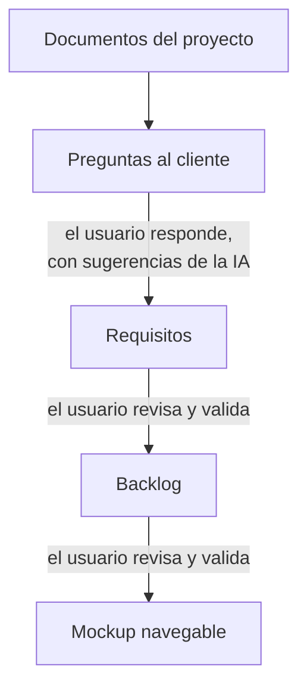

# Concilia

Plataforma web que genera **catálogos de requisitos**, **backlogs ágiles** y un **prototipo navegable** a partir de la documentación de un proyecto, con verificación cruzada entre modelos de IA: dos modelos hacen cada tarea por separado y un tercero, el **árbitro**, compara sus resultados y los une en uno solo, señalando lo que no cuadra para que lo revise el usuario.

El nombre viene de *conciliar* dos versiones. Es el Trabajo Fin de Grado del autor, desarrollado durante sus prácticas en el equipo de análisis de software de Integra Tecnología (Zaragoza).

## Estado

El flujo funciona de principio a fin: documentos → preguntas → requisitos → backlog → mockup, con prompts básicos (iteración v0, de la v0.1 a la v0.9) probados con los modelos de la pasarela de la empresa. Cada trabajo deja un informe con sus tokens, tiempos, acuerdos y discrepancias entre modelos y los cambios del usuario: es la base de la evaluación. Lo que queda está en la [hoja de ruta](#hoja-de-ruta) y en [`docs/plan-de-construccion.md`](docs/plan-de-construccion.md).

## La idea

Un modelo de IA por sí solo puede olvidar información, inventar o contradecirse, y no hay una forma barata de saberlo. Concilia reduce ese riesgo repitiendo cada tarea con dos modelos independientes y comparando ambas salidas: lo que coincide da más confianza, y las discrepancias se marcan para que el usuario las revise antes de validar.

La hipótesis del TFG es que este patrón mejora la fiabilidad frente a usar un único modelo.

## Cómo funciona



| Paso | Qué hace | Cómo |
| --- | --- | --- |
| Documentos | Sube la documentación: Word, PDF, Excel, CSV, PowerPoint, páginas web, correos, transcripciones de reuniones, texto, Markdown, JSON, YAML o XML. Un `.zip` con un mockup del cliente sirve de referencia de estilo. | La plataforma extrae el texto y lo divide en fragmentos citables (`DOC-01#F007`). |
| Preguntas | Las dudas que hay que aclarar con el cliente, en rondas. La IA puede proponer cada respuesta. | Modelo A ‖ modelo B → árbitro |
| Requisitos | El catálogo en EARS y MASTeR, con sus fuentes y las preguntas en que se apoya. | Modelo A ‖ modelo B → árbitro |
| Backlog | Épicas, historias, criterios de aceptación en Gherkin y tareas. | Modelo A ‖ modelo B → árbitro |
| Mockup | Un prototipo navegable de toda la aplicación: inicio de sesión con usuarios de prueba, una aplicación por rol y navegación real. | Un modelo, por pasos: el diseño, cada pantalla, y la plataforma junta y corrige lo que no encaja. |

En las tres fases con árbitro, A y B reciben el mismo prompt y no saben uno del otro. El árbitro recibe las dos propuestas en orden aleatorio, sin saber de qué modelo es cada una, y marca para cada elemento si viene de las dos, de una sola o si hay una discrepancia. Antes, la plataforma empareja las dos propuestas por significado con embeddings calculados en local, sin IA generativa, y el árbitro parte de ese emparejamiento. Si el árbitro se aparta de él (une lo que los números ven distinto o separa lo que ven igual), la plataforma lo marca como discrepancia. Si uno de los dos modelos falla, el trabajo falla: no se acepta la salida de un solo modelo. El usuario revisa cada discrepancia antes de validar, y cada paso solo ve la versión validada del anterior.

Los modelos se ejecutan con Claude Code en modo no interactivo (`claude -p`): leen sus entradas por partes con `Read`, escriben su salida con `Write` y terminan con un veredicto. La plataforma valida cada salida (esquema, referencias, que se haya leído todo) y pide una reparación con la lista de errores si hace falta.

### Notaciones de requisitos

- **[EARS](https://en.wikipedia.org/wiki/Easy_Approach_to_Requirements_Syntax)** es la notación por defecto: plantillas con palabras clave fijas, fáciles de generar y de comprobar automáticamente.
- **MASTeR** (plantillas SOPHIST) se usa para requisitos no funcionales o complejos y para expresar el grado de obligatoriedad (shall, should, may).

La comparación entre notaciones se apoya en [Großer et al., 2024](https://link.springer.com/article/10.1007/s00766-024-00427-0).

## Stack

| Capa | Tecnología |
| --- | --- |
| Frontend | React 19, TypeScript, Vite y Tailwind |
| Backend | .NET 10 (ASP.NET Core) y EF Core |
| Base de datos | PostgreSQL |
| Modelos de IA | Pasarela LiteLLM de la empresa; qué modelo hace cada papel (A, B, árbitro, sugerencias, mockup) es configuración |
| Ejecución de los modelos | Runner en .NET que lanza Claude Code no interactivo (`claude -p`), con salida stream-json y veredicto final obligatorio |
| Embeddings | `paraphrase-multilingual-MiniLM-L12-v2` (Apache 2.0) en ONNX, con ONNX Runtime dentro de la API: en local, sin enviar datos fuera |
| Despliegue | Docker y Docker Compose |

## Estructura del repositorio

```text
concilia/
├── docs/        # plan de construcción, decisiones por hito y evolución de los prompts
├── prompts/     # prompts versionados: v0/ (el flujo actual) y generacion_requisitos/ (catálogo v1.x y v2)
├── src/         # solución .NET: Concilia.Api, Concilia.Core (dominio) y Concilia.Runner
├── tests/       # tests de la solución .NET
├── frontend/    # aplicación React
├── ejemplos/    # dos proyectos ficticios (mediano y grande) con su documentación de análisis
├── scripts/     # utilidades de desarrollo (descargar el modelo de embeddings)
├── models/      # modelo de embeddings descargado para desarrollo local (ignorado por git)
└── data/        # archivos de cada proyecto, trabajo y ejecución (ignorado por git)
```

## Hoja de ruta

- [x] **Hitos 0 a 4.** Repositorio, esqueleto en Docker, subida de archivos, primera llamada a un modelo con progreso en vivo y dos modelos en paralelo.
- [x] **Hitos 5 y 6.** Primer catálogo real y catálogo v1.3–v1.4 por lotes (se conserva como experimento).
- [x] **Hitos 8 a 12b.** Iteración v0: el flujo completo con árbitro, preguntas con sugerencias de la IA, catálogo, backlog y mockup, editables y validables en la web, y lectura de la documentación por partes.
- [x] **Hitos 14 a 16.** Interfaz organizada por pasos, más tipos de archivo, referencia de estilo del mockup y el mockup como una sola aplicación navegable.
- [x] **Hito 13, pasos 63, 64 y 66.** Test del flujo completo, informe automático por trabajo y documentación al día.
- [ ] **Hito 13, paso 65.** Ejecución completa con ReservaSalas y con un segundo documento público.
- [ ] **Hito 7.** Catálogo v2, de arriba abajo, con los prompts del autor.
- [ ] **Después.** Mejorar los prompts fase a fase, árbitro con embeddings y evaluación (precisión, recall y F1 frente a listas de referencia).

## Puesta en marcha

Requisitos: Docker Desktop.

1. Copia `.env.example` a `.env` y rellena los valores:
   - `POSTGRES_PASSWORD`: cualquier valor en local. Con solo esto la aplicación arranca con el proveedor `Fake`, que simula los modelos sin llamar a ninguno.
   - Para usar modelos reales: `RUNNER_PROVIDER=LiteLlm`, `LITELLM_BASE_URL` y `LITELLM_API_KEY`. Los modelos de cada papel (`RUNNER_MODEL_A`, `RUNNER_MODEL_B`, `RUNNER_MODEL_ARBITER`, `RUNNER_MODEL_SUGGESTIONS`) tienen valores por defecto.
   - Para el mockup: `MOCKUP_PROVIDER` (`Fake`, `LiteLlm` o `ClaudeSubscription`) y `MOCKUP_MODEL`. Con `ClaudeSubscription` hace falta `CLAUDE_CODE_OAUTH_TOKEN`, de `claude setup-token`; es solo para uso del autor.
2. Desde la raíz del repositorio:

   ```bash
   docker compose up --build -d
   ```

3. Abre <http://localhost:8080>, crea un proyecto y sigue los pasos.

Los datos se guardan en el volumen de la base de datos y en `data/`, y sobreviven a `docker compose down`. Para borrarlos: `docker compose down -v`.

Reconstruir la API (`docker compose up --build -d`) interrumpe los trabajos en curso: conviene hacerlo sin ninguno en marcha. La primera construcción descarga el modelo de embeddings (470 MB); después Docker lo guarda en caché.

### Desarrollo sin Docker

Con .NET 10 y Node 24 instalados:

- API: `dotnet run --project src/Concilia.Api --launch-profile http` (escucha en <http://localhost:5292>).
- Web: `npm install` y `npm run dev` dentro de `frontend/` (<http://localhost:5173>; reenvía las llamadas a la API).
- Tests: `dotnet test src/Concilia.slnx`. Ninguno llama a la pasarela; el del flujo completo usa `Fake` y una base de datos en memoria.
- Embeddings: la imagen de Docker trae el modelo. Fuera de Docker, `.\scripts\descargar-modelo-embeddings.ps1` lo deja en `models/` (470 MB, con el SHA-256 comprobado), y la API lo usa con `Embeddings__Provider=Onnx` y `Embeddings__ModelPath` apuntando a esa carpeta. Sin él, la API usa `Fake` y los tests que necesitan el modelo se saltan (también en GitHub Actions).

La API necesita una base de datos PostgreSQL en la cadena de conexión `ConnectionStrings__Default`; el endpoint `/health` funciona sin ella.

## Evaluación

Cada trabajo tiene su informe en la vista de ejecuciones («Informe del trabajo»):

- tokens, duración y reparaciones;
- los elementos que propuso cada modelo y qué hizo el árbitro con ellos: de los dos, solo de uno, con discrepancia o descartados;
- lo que cambió el usuario antes de validar;
- en las preguntas, quién escribió cada respuesta.

Todos los trabajos de un proyecto se descargan como CSV, un trabajo por fila, desde la misma vista. La evolución de cada versión de los prompts, con sus resultados medidos, está en [`docs/evolucion-prompt-requisitos.md`](docs/evolucion-prompt-requisitos.md).

## Configuración y secretos

Las credenciales y las direcciones de servicios internos se pasan por variables de entorno y **nunca** se suben al repositorio. El archivo `.env` está en `.gitignore`; el repositorio solo incluye `.env.example`, con los nombres de las variables y sin valores. La plataforma oculta la clave y la dirección de la pasarela en los registros, los eventos y la base de datos.

## Licencia

Sin definir; pendiente de acordar con la tutora y con la empresa.

## Autoría

Autor: `Carlos Alejos Fumanal` · Tutores: `Francisco Javier Zarazaga-Soria & Patricia Berdejo`
