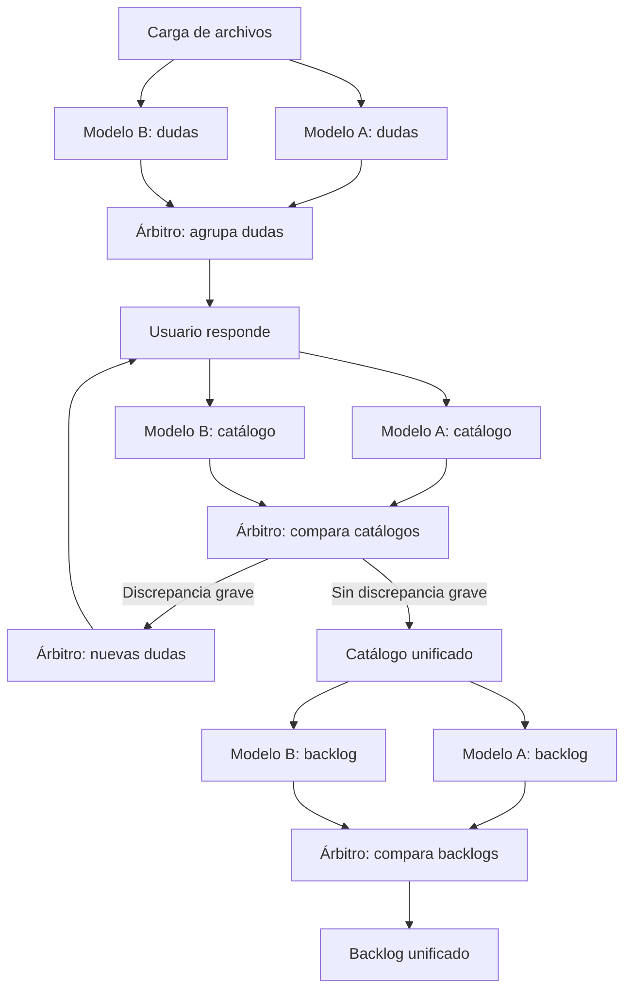

# ReqArbiter

> Nombre provisional del proyecto.

Plataforma web que genera **catálogos de requisitos** y **backlogs ágiles** a partir de documentación, con verificación cruzada entre modelos de IA: dos modelos trabajan cada tarea de forma independiente y un tercero, el **árbitro**, compara sus resultados, pregunta lo que haga falta y los fusiona en uno solo.

Es el Trabajo Fin de Grado del autor, desarrollado durante sus prácticas en el equipo de análisis de software de Integra Tecnología (Zaragoza).

## Estado

Proyecto en fase inicial: todavía no hay código de la aplicación. Este README describe el objetivo y el plan, y se actualizará con cada hito.

## La idea

Un modelo de IA por sí solo puede olvidar información, inventar o contradecirse, y no hay una forma barata de saberlo. ReqArbiter reduce ese riesgo repitiendo cada tarea con dos modelos independientes y comparando ambas salidas: lo que coincide da más confianza, y las discrepancias se detectan, se preguntan al usuario si son graves y se resuelven antes de fusionar.

La hipótesis del TFG es que este patrón mejora la fiabilidad frente a usar un único modelo. Se evaluará con métricas automáticas (precisión, recall y F1 sobre enlaces de trazabilidad, y cobertura por similitud) y, si procede, con validación humana apoyada en una guía de anotación.

## Cómo funciona

El sistema aplica el mismo patrón en tres fases.



| Fase | Entrada | Salida |
|---|---|---|
| 1. Dudas | Archivos cargados | Lista única de preguntas para el usuario |
| 2. Catálogo | Archivos y respuestas | Catálogo de requisitos unificado |
| 3. Backlog | Catálogo unificado | Backlog ágil unificado (jerarquía de niveles por confirmar) |

### Notaciones de requisitos

- **[EARS](https://en.wikipedia.org/wiki/Easy_Approach_to_Requirements_Syntax)** es la notación por defecto: plantillas con palabras clave fijas, fáciles de generar y de comprobar automáticamente.
- **MASTeR** (plantillas SOPHIST) se usa como respaldo para requisitos no funcionales o complejos y para expresar el grado de obligatoriedad (shall, should, may).

La comparación entre notaciones se apoya en [Großer et al., 2024](https://link.springer.com/article/10.1007/s00766-024-00427-0).

## Stack

| Capa | Tecnología |
|---|---|
| Frontend | React 19, TypeScript, Vite y Tailwind |
| Backend | .NET 10 (ASP.NET Core) y EF Core |
| Base de datos | PostgreSQL |
| Modelos de IA | Pasarela LiteLLM de la empresa; los roles de Modelo A, Modelo B y árbitro son configurables |
| Ejecución de los modelos | Runner en .NET que lanza Claude Code no interactivo (`claude -p`), con salida stream-json y veredicto final obligatorio |
| Despliegue | Docker y Docker Compose |

## Estructura prevista del repositorio

Se creará de forma incremental, según lo necesite cada hito.

```
reqarbiter/
├── docs/          # decisiones de arquitectura, investigación, diseño y memoria
├── prompts/       # prompts versionados por fase
├── src/           # solución .NET: API, dominio, runner y árbitro
├── tests/         # tests de la solución .NET
├── frontend/      # aplicación React
├── evaluation/    # descarga de datasets, notebooks y resultados
└── data/          # archivos de trabajo (ignorado por git)
```

## Hoja de ruta

- [x] **Hito 0.** Preparación del repositorio y prueba de humo de la pasarela con Claude Code.
- [x] **Hito 1.** Esqueleto que arranca en Docker: API, base de datos y web mínima.
- [x] **Hito 2.** Subida de archivos y extracción de texto, sin IA.
- [x] **Hito 3.** Primera llamada a un modelo desde la web, con progreso en vivo.
- [x] **Hito 4.** Doble modelo en paralelo, sin árbitro.
- [ ] **Hito 5.** Primer catálogo de requisitos real, validado.
- [ ] **Después.** Árbitro con embeddings y fusión, fase de dudas, backlog, aprobación por umbral y evaluación.

## Puesta en marcha

Requisitos: Docker Desktop.

1. Copia `.env.example` a `.env` y rellena los valores. Para arrancar la aplicación basta con `POSTGRES_PASSWORD` (cualquier valor en local); las variables de LiteLLM se necesitan a partir del hito 3.
2. Desde la raíz del repositorio:

   ```bash
   docker compose up --build -d
   ```

3. Abre <http://localhost:8080>.

Los datos se guardan en el volumen `db-data` y sobreviven a `docker compose down`. Para borrarlos: `docker compose down -v`.

### Desarrollo sin Docker

Con .NET 10 y Node 24 instalados:

- API: `dotnet run --project src/ReqArbiter.Api --launch-profile http` (escucha en <http://localhost:5292>).
- Web: `npm install` y `npm run dev` dentro de `frontend/` (<http://localhost:5173>; reenvía las llamadas a la API).
- Tests: `dotnet test src/ReqArbiter.slnx`.

La API necesita una base de datos PostgreSQL en la cadena de conexión `ConnectionStrings__Default`; el endpoint `/health` funciona sin ella.

## Configuración y secretos

Las credenciales y las direcciones de servicios internos se pasan por variables de entorno y **nunca** se suben al repositorio. El archivo `.env` está en `.gitignore`; el repositorio solo incluirá un `.env.example` con los nombres de las variables, sin valores.

## Licencia

Sin definir; pendiente de acordar con la tutora y con la empresa.

## Autoría

Autor: `Carlos Alejos Fumanal` · Tutores: `Francisco Javier Zarazaga-Soria & Patricia Berdejo`
